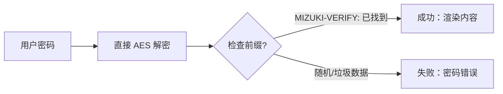

本文演示了浏览器端的密码保护功能。密码被有意保留在仓库中，以便读者可以打开该示例；切勿在私人内容中重复使用它。

## 博文的前置元数据（Front-matter）

```yaml
---
title: 我的第一篇博文
published: 2023-09-09
description: 这是我的新 Astro 博客的第一篇文章。
image: ./cover.jpg
tags: [Foo, Bar]
category: 前端
draft: false
---
```

| 属性 | 描述 |
| :--- | :--- |
| `title` | 文章标题。 |
| `published` | 文章发布日期。 |
| `pinned` | 是否将此文章置顶。 |
| `description` | 文章简短描述，显示在首页。 |
| `image` | 文章封面图路径。<br/>1. 以 `http://` 或 `https://` 开头：使用 Web 图片<br/>2. 以 `/` 开头：用于 `public` 目录下的图片<br/>3. 无以上前缀：相对于 Markdown 文件路径 |
| `tags` | 文章标签。 |
| `category` | 文章分类。 |
| `alias` | 文章别名。文章可在 `/posts/{alias}/` 访问。示例：`my-special-article`（将可在 `/posts/my-special-article/` 访问）。 |
| `licenseName` | 文章内容的许可名称。 |
| `author` | 文章作者。 |
| `sourceLink` | 文章内容的源链接或参考链接。 |
| `draft` | 如果此文章仍为草稿，则不会显示。 |
| `encrypted` | 此文章是否受密码保护。 |
| `password` | 解锁加密文章的密码。 |
| `passwordHint` | 帮助用户记忆密码的提示，显示在密码输入框下方。 |
| `hideHomeContent` | 是否隐藏公开的文章摘要，包括首页、元标签、Feed/API 摘要以及分享预览。当设置了 `password` 时，默认为 `true`。 |

## 文章文件放置位置

你的文章文件应该放在 `src/content/posts/` 目录下。你也可以创建子目录来更好地组织你的文章和资源。

```
src/content/posts/
├── post-1.md
└── post-2/
    ├── cover.png
    └── index.md
```

## 文章别名

你可以通过在 Front-matter 中添加 `alias` 字段来为任何文章设置别名：

```yaml
---
title: 我的特色文章
published: 2024-01-15
alias: "my-special-article"
tags: ["示例"]
category: "技术"
---
```

当设置了别名后：
- 文章将可以通过自定义 URL 访问（例如，`/posts/my-special-article/`）
- 默认的 `/posts/{slug}/` URL 仍然有效
- RSS/Atom Feed 将使用自定义别名
- 所有内部链接将自动使用自定义别名

**重要注意事项：**
- 别名不应包含 `/posts/` 前缀（它会自动添加）
- 避免在别名中使用特殊字符和空格
- 为了获得最佳 SEO 效果，请使用小写字母和连字符
- 确保别名在所有文章中是唯一的
- 不要包含前导或尾随斜杠

## 工作原理



## 页面加密

你可以通过在 Front-matter 中设置 `encrypted: true` 并提供 `password` 来保护任何文章的密码：

```yaml
---
title: 我的私人文章
published: 2024-01-15
encrypted: true
password: "my-secret-password"
passwordHint: "提示：密码是我宠物的名字"
hideHomeContent: true
---
```

### 字段

| 字段 | 必填 | 描述 |
| :--- | :--- | :--- |
| `encrypted` | 是 | 设置为 `true` 以启用密码保护 |
| `password` | 是 | 解锁文章的密码 |
| `passwordHint` | 否 | 显示在密码输入框下方的提示 |
| `hideHomeContent` | 否 | 将公开摘要隐藏为 `该文章已加密`。设置密码时默认为 `true`。设置为 `false` 以显示正常摘要。 |

### 解锁框的样子

解锁框显示：
- 主题色的锁图标
- 文章标题“密码保护”
- 要求输入密码的描述
- 提示（如果提供了 `passwordHint`）
- 密码输入框和解锁按钮

输入正确密码后，内容将被解密并显示。密码存储在会话存储（session storage）中，因此用户无需在同一会话的后续页面加载时重新输入。
