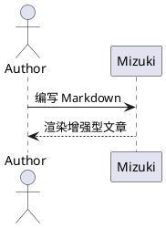
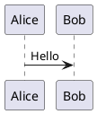

## GitHub 仓库卡片
你可以添加动态卡片链接到 GitHub 仓库。页面加载时，仓库信息将通过 GitHub API 获取。

::github{repo="LyraVoid/Mizuki"}

使用代码 `::github{repo="LyraVoid/Mizuki"}` 创建 GitHub 仓库卡片。

```markdown
::github{repo="LyraVoid/Mizuki"}
```

## 标注 (Admonitions)

支持以下类型的标注：`note` `tip` `important` `warning` `caution`

:::note
突出显示用户即使在略读时也应注意的信息。
:::

:::tip
帮助用户更成功的可选信息。
:::

:::important
用户成功所需的关键信息。
:::

:::warning
由于潜在风险，需要用户立即关注的关键内容。
:::

:::caution
操作可能产生的负面后果。
:::

### 基本语法

```markdown
:::note
突出显示用户即使在略读时也应注意的信息。
:::

:::tip
帮助用户更成功的可选信息。
:::
```

### 自定义标题

标注的标题可以自定义。

:::note[我的自定义标题]
这是一个带有自定义标题的注释。
:::

```markdown
:::note[我的自定义标题]
这是一个带有自定义标题的注释。
:::
```

### GitHub 语法

> [!TIP]
> [GitHub 语法](https://github.com/orgs/community/discussions/16925) 也受支持。

```
> [!NOTE]
> GitHub 语法也受支持。

> [!TIP]
> GitHub 语法也受支持。
```

### 剧透 (Spoiler)

你可以为文本添加剧透效果。该文本同样支持 **Markdown** 语法。

内容 :spoiler[是隐藏的 **ayyy**]！

```markdown
内容 :spoiler[是隐藏的 **ayyy**]！
```

## 代码组

使用 VitePress 风格的 `::: code-group labels=[...]` 语法，将相关示例以易于访问的标签页形式呈现。标签页支持鼠标输入以及 <kbd>Left</kbd>（左）、<kbd>Right</kbd>（右）、<kbd>Home</kbd> 和 <kbd>End</kbd> 键。

::: code-group labels=[TypeScript, Shell, 折叠]

```ts title="config.ts" showLineNumbers {2} ins={3}
export const config = {
  framework: "Mizuki",
  enhanced: true,
};
```

```bash title="构建"
pnpm check && pnpm build
```

```js collapse={1-3}
import { one } from "one";
import { two } from "two";
import { three } from "three";
console.log(one, two, three);
```

:::

````markdown
::: code-group labels=[TypeScript, Shell]

```ts title="config.ts"
export const framework = "Mizuki";
```

```bash title="构建"
pnpm build
```

:::
````

### 长代码自动折叠

超过配置阈值的代码块会自动折叠。作者可以继续使用 `collapse={...}` 来折叠选定的行范围。

```text
01
02
03
04
05
06
07
08
09
10
11
12
13
14
15
16
17
18
19
20
21
22
```

## 扩展标注

除了 GitHub 的五种提醒类型外，Mizuki 还接受常见的 Obsidian 别名，例如 `INFO`、`TODO`、`SUCCESS`、`QUESTION`、`DANGER`、`BUG`、`EXAMPLE` 和 `QUOTE`。

> [!BUG] 已知限制
> 扩展别名已映射到 Mizuki 的语义标注样式。

同时也支持 Python Markdown 和 Docusaurus 风格的指令：

:::danger[危险指令]
此指令使用了自定义标题。
:::

```markdown
> [!BUG] 已知限制
> 在此处描述已知问题。

:::danger[危险指令]
此指令使用了自定义标题。
:::
```

## Wiki 链接

Obsidian 风格的 Wiki 链接可以解析文章路径、别名和标题锚点。独立的链接会成为文章卡片：

[[guide]]

卡片会复用目标文章的封面。相对封面会从目标文章中解析，同时也支持公共、远程和配置的 `image: api` 封面。加密文章不会在预览中显示其封面。

内联链接保持内联。参见 [[markdown-mermaid|Mermaid 示例]]，或直接链接到 [[markdown-mermaid#Flowchart Example|某个章节]]。

```markdown
[[markdown-mermaid]]

参见 [[markdown-mermaid|Mermaid 示例]]。
```

## Markdown 图像

图像 alt 文本仍可供辅助技术使用。Markdown 标题将作为可见的标题显示，可选的已验证 `w-N%` 标记可控制显示宽度：


```markdown

```

仅接受从 `w-1%` 到 `w-100%` 的宽度。`imageOptimization.noReferrerDomains` 中的远程图像主机在初始 HTML 中会收到 `referrerpolicy="no-referrer"`。当自定义标记应保持不变时，请在原始 HTML 图像或其父级元素上添加 `data-no-enhance`。

```html
<div data-no-enhance>
  
</div>
```

## 自动图像网格

两个或多个相邻的独立图像会被归入一个响应式图库中。当需要自定义列、纵横比或对象填充时，显式的 `:::grid` 指令仍然可用。


```markdown


```

## PlantUML

PlantUML 代码块通过配置的服务器生成 SVG 图表。图表支持亮色和暗色主题，以及缩放、拖拽、重置和全屏查看。



````markdown

````

## 化学

KaTeX 的 `mhchem` 扩展可渲染化学方程式：

$$
\ce{H2O + CO2 -> H2CO3}
$$
